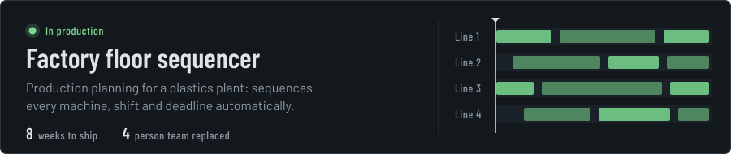
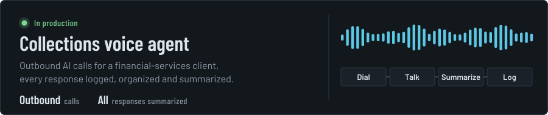
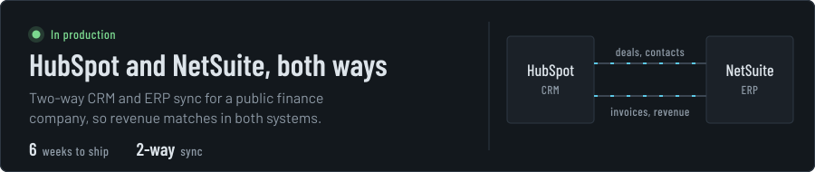
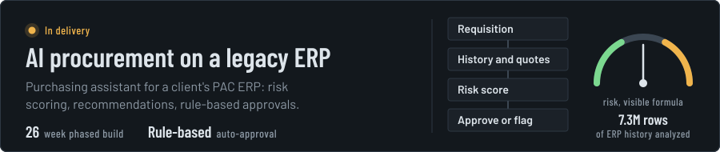
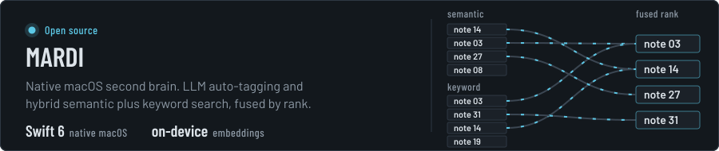
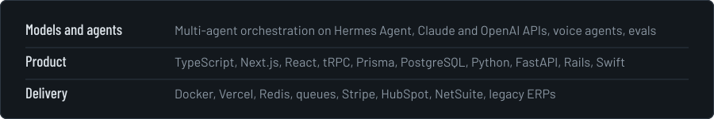

  Client work lives in private repos. Case studies at <a href="https://sebb.ai"><b>sebb.ai</b></a>
  &nbsp;·&nbsp; <a href="https://linkedin.com/in/sebastian-burke">LinkedIn</a>
  &nbsp;·&nbsp; <a href="mailto:EMAIL">Email</a>

